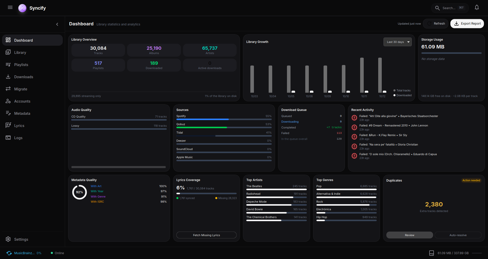
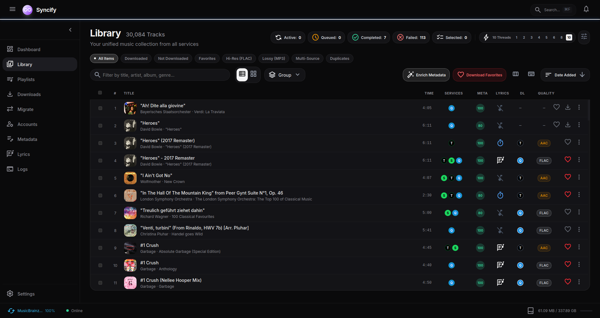
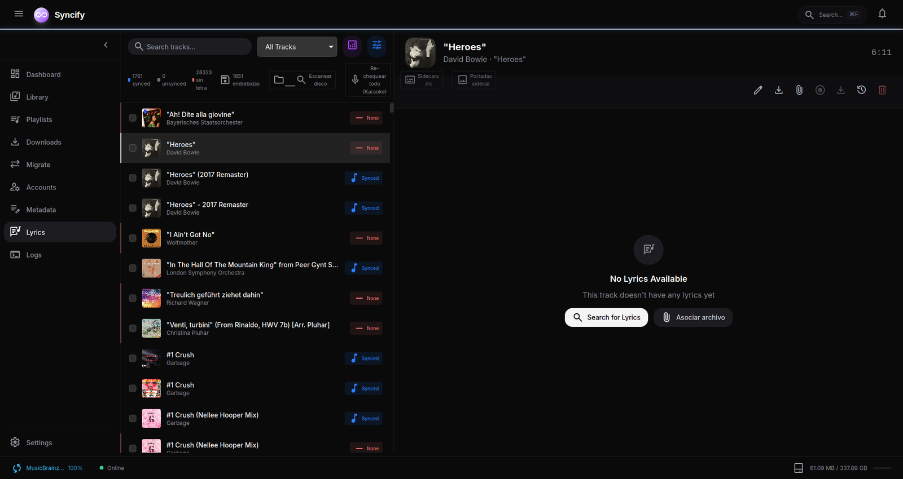
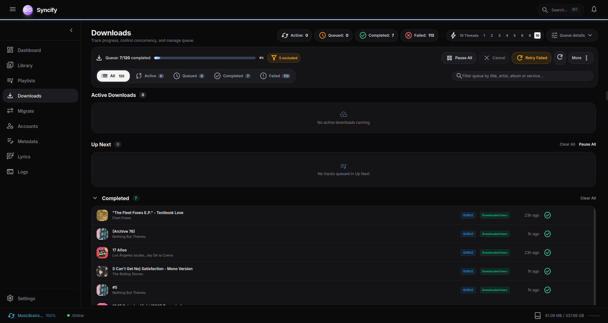
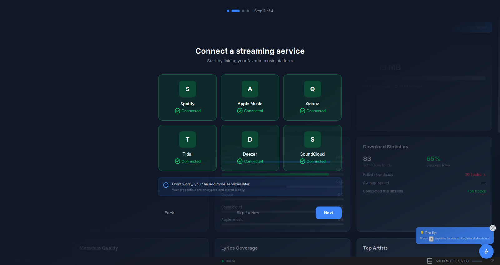
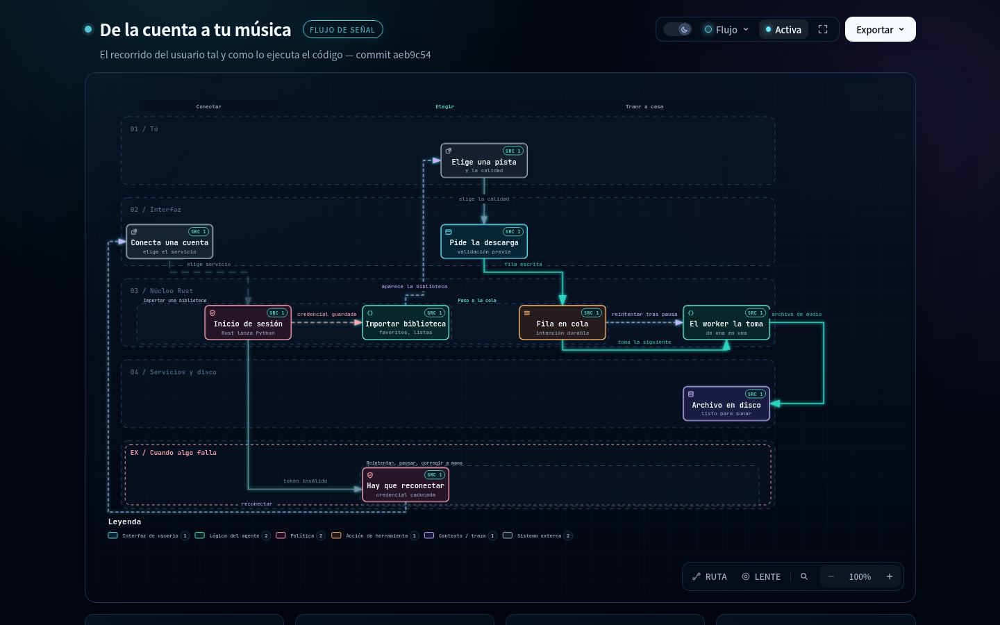
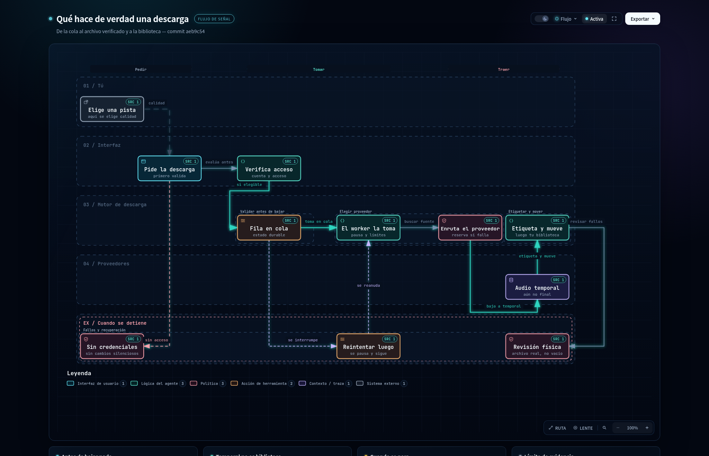
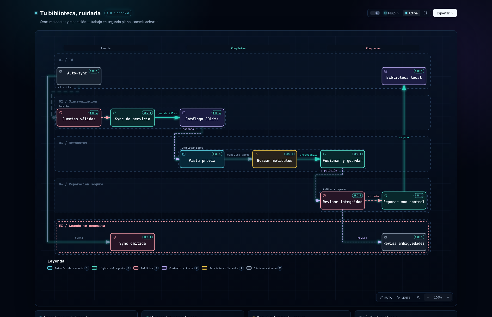
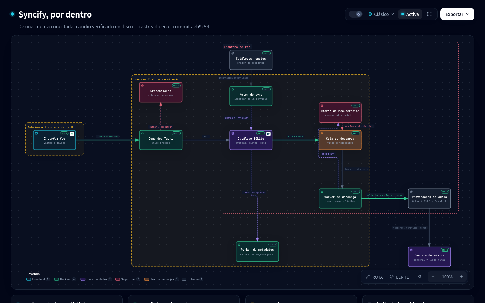

<div align="center">

# Syncify

**Toda tu biblioteca musical. Máxima calidad. Bajo tu control.**

Conecta Qobuz, Tidal, Spotify, Deezer, SoundCloud y Apple Music. Importa tu
biblioteca, descárgala en la mejor calidad disponible y conserva una
biblioteca local perfectamente organizada, con archivos reales, lista para
Symfonium, Plexamp o cualquier reproductor que quieras.

[English](README.md) · [Español](README.es.md)

**[⬇ Descarga la última versión](https://github.com/MadManJohnSmith/Syncify/releases/latest)**
· [Compila desde fuente](#compilar-desde-fuente) · [Documentación](docs/README.md)

> **Estado de la release (2026-10-12):** las funciones de abajo están
> publicadas en [Syncify v0.6.0](https://github.com/MadManJohnSmith/Syncify/releases/tag/v0.6.0)
> (el PR #26 se fusionó en `main` por squash como `94376b4`). El enlace de
> descarga de arriba ahora apunta a v0.6.0. Consulta
> [verificación y limitaciones](#verificación-y-limitaciones) para saber qué no
> está verificado en un entorno real.

[](https://github.com/MadManJohnSmith/Syncify/releases/latest)
[](https://github.com/MadManJohnSmith/Syncify/actions/workflows/ci.yml)
[](https://tauri.app/)
[](https://www.rust-lang.org/)
[](https://vuejs.org/)
[](https://tailwindcss.com/)
[](https://www.sqlite.org/)

**Windows** instalador y portable · **Linux** AppImage, DEB y tarball

</div>

---

## Véalo en acción



| | |
|---|---|
|  |  |
| *Todo tu catálogo, unificado* | *Letras sincronizadas, guardadas como .lrc* |
|  |  |
| *Un motor de descargas que controlas* | *Un login por servicio, todo queda sincronizado* |

---

## ¿Por qué Syncify?

Los servicios de streaming te alquilan la música. Si te vas — o el servicio
pierde una licencia, o quitan una pista — tu biblioteca se va contigo. Syncify
le da la vuelta: convierte "tu" catálogo en *tu* catálogo.

- **Cambia de servicio sin dejar tu música atrás.** Importa tus favoritos,
  álbumes, artistas y playlists — más compras e historial de escucha cuando el
  proveedor los expone — y migra a otro servicio, o descárgalo y sé dueño de
  verdad. La cobertura no es idéntica en todos los proveedores; la
  [matriz de paridad de importación](docs/MATRIZ_PARIDAD_IMPORTACION.md) tiene
  la verdad servicio por servicio.
- **Archivos reales, no licencias.** Las descargas quedan como FLAC
  correctamente etiquetado (hasta Hi-Res 24-bit/192 kHz) o MP3, verificado
  contra lo que el proveedor prometió.
- **Una biblioteca, todos los servicios.** Una sola importación reúne en una
  biblioteca deduplicada todos los servicios que conectes, y el motor
  reconoce la misma canción venga de donde venga. Marcar una pista como
  favorita dentro de Syncify es una marca **local**: tus cuentas solo se
  escriben desde la herramienta de migración, no desde la vista de biblioteca.

## ¿Qué puedes hacer con Syncify?

- **Importa tu biblioteca** de Qobuz, Tidal, Spotify, Deezer, SoundCloud,
  Apple Music, o tus **carpetas de música locales** — pistas, álbumes,
  artistas y playlists. Escanea tus archivos físicos del disco y deduplícalos
  frente a catálogos de streaming por ISRC y hash de audio, con paridad de
  puntuación de metadatos.
- **Reproduce con el reproductor integrado**: reproductor unificado centrado en
  la barra inferior con expansión de carátula al hover, y un reproductor a
  pantalla completa con letras sincronizadas (`.lrc`) con auto-desplazamiento,
  visualizador de folletos digitales (`.pdf`) y carátulas animadas.
- **Migra entre servicios**: elige origen, elige destino, revisa las
  coincidencias y transfiere. Syncify primero empareja por ISRC y después por
  título y artista, y transfiere lo que encuentra como **favoritos en la
  cuenta de destino**. Aún no reconstruye tus playlists allí.
- **Descarga con cascada de calidad estricta**: fallback cruzado sin pérdida
  (Qobuz ↔ Tidal) que prioriza calidad FLAC/CD entre servicios antes de degradar,
  imponiendo un piso mínimo estricto de 320 kbps y verificación física en disco.
- **Metadatos de nivel profesional automáticos**: artistas múltiples,
  colaboraciones y compilaciones bien resueltas, países, BPM, tonalidad y
  energía — desde MusicBrainz, AcoustID y Last.fm.
- **Letras sincronizadas como `.lrc`**, resueltas con una cascada de 16
  estrategias sobre 10 proveedores.
- **Portadas en alta resolución** (incluidas animadas) guardadas junto a tu
  música, organizadas en carpetas por artista y álbum bajo `~/Music/Syncify`.
- **Manténla sana**: deduplicación y fusión, auditorías de identidad del
  catálogo, chequeos de integridad y un pipeline de reparación con historial
  auditable.
- **Playlists inteligentes** con reglas, construidas sobre tu propia
  biblioteca.

## Cómo funciona

1. **Conecta una cuenta.** La app abre un flujo de login seguro por servicio
   (OAuth/captura de sesión en el navegador) y guarda tus credenciales
   cifradas en tu máquina.
2. **Importa.** Un motor unificado en Rust recorre la API del servicio con
   paginación, resuelve la identidad canónica de cada pista (ISRC, IDs del
   proveedor), la enriquece y la persiste transaccionalmente, con retry,
   en tu biblioteca SQLite local.
3. **Descarga.** Pipelines nativos manejan el formato de entrega de cada
   proveedor — Qobuz sirve URL directas de FLAC y Tidal entrega flujos
   segmentados que el pipeline ensambla — y escriben archivos FLAC/MP3 reales
   con metadatos, portadas y letras embebidas, y verifican que lo que
   aterrizó en disco coincide con lo prometido.
4. **Disfrútala donde quieras.** El resultado es un árbol de carpetas plano
   con archivos sidecar — sin encierro propietario. Apunta Symfonium,
   Plexamp, Roon o cualquier reproductor y funciona.

Bajo el capó: una app de escritorio **Tauri 2** (núcleo Rust + UI en Vue 3)
con IPC tipado, un motor de descarga/reparación multihilo y un esquema local
endurecido a lo largo de **91 migraciones SQL en este árbol de trabajo** (87
confirmadas más 4 nuevas aquí). Los logins de servicios
corren por puentes Python pequeños y auditados (Playwright, Mutagen, AcoustID).

### Cómo encaja todo

Cada tarjeta es un diagrama vivo — ábrelo para pasar el ratón, arrastrar y ampliar.

<table width="100%">
<tr>
  <td width="50%" valign="top">
    <a href="https://madmanjohnsmith.github.io/Syncify/docs/diagrams/user-journey.html"></a>
    <p align="center"><a href="https://madmanjohnsmith.github.io/Syncify/docs/diagrams/user-journey.html"><b>De la cuenta a tu música</b></a> — lo que Syncify hace por ti</p>
  </td>
  <td width="50%" valign="top">
    <a href="https://madmanjohnsmith.github.io/Syncify/docs/diagrams/download-journey.html"></a>
    <p align="center"><a href="https://madmanjohnsmith.github.io/Syncify/docs/diagrams/download-journey.html"><b>Qué pasa cuando descargas</b></a> — de tu servicio a tu disco, paso a paso</p>
  </td>
</tr>
<tr>
  <td width="50%" valign="top">
    <a href="https://madmanjohnsmith.github.io/Syncify/docs/diagrams/library-care.html"></a>
    <p align="center"><a href="https://madmanjohnsmith.github.io/Syncify/docs/diagrams/library-care.html"><b>Tu biblioteca, cuidada</b></a> — sincronización, orden y recuperación solos</p>
  </td>
  <td width="50%" valign="top">
    <a href="https://madmanjohnsmith.github.io/Syncify/docs/diagrams/architecture.html"></a>
    <p align="center"><a href="https://madmanjohnsmith.github.io/Syncify/docs/diagrams/architecture.html"><b>Bajo el capó</b></a> — cómo encajan las piezas (para los curiosos)</p>
  </td>
</tr>
</table>

Diagramas en español: [de la cuenta a tu música](docs/diagrams/user-journey.html) · [qué pasa cuando descargas](docs/diagrams/download-journey.html) · [tu biblioteca, cuidada](docs/diagrams/library-care.html) · [bajo el capó](docs/diagrams/architecture.html)

## Servicios soportados

| | Favoritos | Álbumes/Artistas | Playlists | Historial | Destino de migración |
|---|---|---|---|---|---|
| **Qobuz** | ✅ | ✅ | ✅ | ✅ | ✅ |
| **Tidal** | ✅ | ✅ | ✅ | ✅ | ✅ |
| **Spotify** | ✅ | ✅ | ✅ | ✅ | ✅ |
| **Deezer** | ✅ | ✅ | ✅ | — ⁽¹⁾ | ✅ |
| **SoundCloud** | ✅ | ✅ ⁽²⁾ | — ⁽¹⁾ | — ⁽¹⁾ | ✅ |
| **Apple Music** | ✅ ⁽³⁾ | ✅ ⁽³⁾ | ✅ | — | ✅ |

⁽¹⁾ La API pública del proveedor no lo expone — Syncify avisa en vez de fingir.
⁽²⁾ Se derivan del `publisher_metadata` de cada like; la API no tiene endpoint de álbumes favoritos.
⁽³⁾ Apple Music importa por su propio importador fiel al ISRC (storefront
configurable); el camino del motor unificado está documentado en la matriz
de paridad.

La matriz completa y honesta por fase vive en
[`docs/MATRIZ_PARIDAD_IMPORTACION.md`](docs/MATRIZ_PARIDAD_IMPORTACION.md).

## Instalación

Descarga la última build de la página de
[**Releases**](https://github.com/MadManJohnSmith/Syncify/releases):

| Plataforma | Archivos |
|---|---|
| **Windows** | `Syncify_*_x64-setup.exe` (instalador) · `Syncify-Windows-Portable.zip` |
| **Linux** | `*.AppImage` · `*.deb` · `Syncify-Linux-x86_64.tar.gz` (binario crudo + binarios incluidos) |

Las dos plataformas empaquetan sus propias copias de las herramientas
externas, así que una instalación reciente no tiene nada más que descargar ni
configurar:

- `ffmpeg`, `ffprobe` y `fpcalc` (Chromaprint) viajan como entradas
  `bundle.externalBin`; el AppImage de Linux lleva además los plugins mínimos
  de GStreamer, sin los que arrancaría pero no sonaría.
- Un runtime de Python privado con los puentes de servicios ya instalados, así
  que nunca se pide el Python del sistema.

Algunas funciones dependen de algo que los paquetes no pueden incluir:

- **Los logins por navegador** (Qobuz, Deezer, SoundCloud, Apple Music) usan un
  navegador de la familia Chromium ya instalado en tu sistema (Chrome,
  Chromium, Brave, Edge, Vivaldi…). Tidal entra por su página de código de
  dispositivo en tu navegador por defecto y Spotify usa el WebView propio de la
  app: esos dos no necesitan nada extra.
- **El AppImage necesita FUSE 2** en el sistema (Ubuntu 23.04+ lo trae como
  `libfuse2t64`). Si no arranca, ejecútalo con `--appimage-extract-and-run`, o
  usa el DEB o el tarball.
- **El audio en Linux** va por ALSA; en un sistema solo-PipeWire instala
  `pipewire-alsa` (o los plugins de ALSA).
- **En Windows**, el instalador aún no está firmado: SmartScreen puede mostrar
  una vez "Windows protegió tu PC" — elige *Más información* → *Ejecutar de
  todas formas*.

Después:

1. Corre el asistente de primera ejecución: conecta tus cuentas, elige tu
   carpeta de música, listo. Las credenciales se cifran y se guardan en la
   base de datos SQLite propia de Syncify, dentro de la carpeta de perfil de
   la app. La clave de cifrado vive en el llavero de tu sistema operativo
   cuando hay uno disponible, y si no (Linux sin sesión gráfica, sin Secret
   Service) cae a un archivo `.crypto_key` con permisos `0600` en esa misma
   carpeta de perfil: en esos Linux esa es la vía prevista, no un fallo.

> ¿Compilando desde fuente? Mira
> [`src-tauri/binaries/README.md`](src-tauri/binaries/README.md) para saber
> cómo se proveen los binarios empaquetados en builds locales de producción.

## Preguntas frecuentes

**¿Sobrevive mi biblioteca si desinstalo Syncify?**

Sí. Las descargas son archivos FLAC/MP3 en carpetas normales, con portadas y
letras `.lrc` como sidecars. Ninguna base de datos propietaria las mantiene
juntas: Symfonium, Plexamp, Roon o cualquier reproductor las lee
directamente.

**¿Dónde viven las credenciales de mis servicios?**

Cifradas dentro de la base de datos SQLite propia de Syncify, en la carpeta
de perfil de la app en tu máquina. La clave de cifrado se guarda en el
llavero de tu sistema operativo cuando hay uno disponible — el Administrador
de credenciales en Windows, el Secret Service (GNOME Keyring/KWallet) en
Linux; donde no lo hay (Linux sin sesión gráfica, sin Secret Service), la
clave cae a un archivo `.crypto_key` con permisos `0600` en esa misma carpeta
de perfil. Cada login corre por tu navegador y ninguna credencial se escribe
nunca en un archivo de configuración plano.

**¿Qué calidad puedo esperar?**

El motor apunta al mejor nivel que cada servicio ofrezca (FLAC hasta Hi-Res
24-bit/192 kHz) y baja de nivel cuando ese no está. En el fallback cruzado
Qobuz→Tidal se prefiere la capa sin pérdida antes de cualquier paso con pérdida,
y un candidato por debajo de 320 kbps se rechaza en vez de escribirse. Cada
archivo se re-inspecciona en disco y se verifica contra lo que el proveedor
prometió antes de darse por bueno.

**¿Hay versión para macOS?**

No. Windows (instalador y portable) y Linux (AppImage, DEB, tarball) son las
plataformas soportadas.

**¿Puedo descargar de Spotify, Deezer, SoundCloud o Apple Music?**

De esos servicios, directamente, no. Los motores de descarga funcionan hoy
encaminando la coincidencia a una tubería nativa de entrega (Qobuz y Tidal) o,
pasando por una resolución SongLink, a un respaldo de Amazon Music; Spotify,
Deezer, SoundCloud y Apple Music no ofrecen un flujo descargable. En la
práctica la app marca qué pistas no encontraron fuente en vez de saltarlas en
silencio.

**¿Está terminada la app?**

No, y esta página no lo afirma. Syncify es previo a la 1.0, y las funciones
descritas arriba están publicadas en v0.6.0. La release no demuestra el
comportamiento en entornos reales pendiente de
[verificación y limitaciones](#verificación-y-limitaciones).

### Verificación y limitaciones

El PR #26 se fusionó en `main` por squash como `94376b4`; el cambio de
documentación de `5dcf4b6` se fusionó por squash como `ed440a9` (PR #27). El
tag `v0.6.0` apunta exactamente a
`ed440a96f669c264a7e477e76b791e325e900b7f` y la
[release de Syncify v0.6.0](https://github.com/MadManJohnSmith/Syncify/releases/tag/v0.6.0)
está publicada con cinco artefactos para Linux y Windows. Sus notas provienen
de [las notas de la versión 0.6.0](docs/RELEASE_NOTES_v0.6.0.md). La CI de
Rust, frontend y Python, la puerta de release y ambos builds de publicación
(Linux y Windows) quedaron en verde sobre esa misma revisión. Lo que **no** se
ha demostrado aquí:

- **La sesión gráfica.** El diseño de la UI, la reproducción de audio, la
  bandeja, MPRIS/D-Bus y el comportamiento en el gestor de ventanas no se han
  ejercitado en un escritorio real.
- **La red en vivo.** Ningún login de arranque, enriquecimiento con proveedores,
  descarga ni resolución de letras ha corrido contra servicios reales.
- **Tests de Rust ignorados.** Los 9 tests ignorados que necesitan red o
  credenciales no se han ejercitado.
- **Windows.** La comprobación cruzada del target `x86_64-pc-windows-msvc` no
  se ha ejecutado en esta máquina, aunque la CI produjo los instaladores de
  Windows.

Nada de eso lo demuestran ni la release ni la CI en verde, así que nada de eso
debe anunciarse como funcionando.

Las insignias `Release` y `CI` de arriba no informan sobre los puntos de esta
lista.

## Compilar desde fuente

Requisitos: **Rust** (estable), **Node.js 20+**, **Python 3.11+** y `ffmpeg`,
`flac` y `fpcalc` en tu `PATH`. En Linux además necesitas los paquetes de
desarrollo de WebKit2GTK/GTK (`libwebkit2gtk-4.1-dev`, `libgtk-3-dev`,
`libayatana-appindicator3-dev`, `librsvg2-dev`).

```bash
git clone https://github.com/MadManJohnSmith/Syncify.git
cd Syncify

# CLI de Tauri (raíz del repo) + dependencias del frontend
npm install
cd ui && npm ci && cd ..

# Puentes Python (logins de servicios, metadatos, fingerprinting)
python3 -m venv .venv
source .venv/bin/activate
pip install -r scripts/requirements.txt
playwright install chromium

# Modo desarrollo (con recarga en caliente de la UI)
npm run dev

# Build de producción (instalador para tu SO)
npm run build
```

## Documentación

- [`docs/`](docs/README.md) — arquitectura y features · [índice en inglés](docs/README.en.md)
- [`docs/MATRIZ_PARIDAD_IMPORTACION.md`](docs/MATRIZ_PARIDAD_IMPORTACION.md) — matriz viva de paridad de importación
- [`docs/LYRICS_16_PROVIDER_MATRIX.md`](docs/LYRICS_16_PROVIDER_MATRIX.md) — la cascada de letras, auditada
- [`docs/Deuda_Tecnica_y_UX.md`](docs/Deuda_Tecnica_y_UX.md) — deuda técnica abierta, rastreada a la vista

## Contribuir

Las contribuciones son bienvenidas: bugs, mejoras de UI, nuevos proveedores
de letras o metadatos, más servicios, documentación. Haz fork, crea una rama
enfocada y abre un PR contra `main` — la rama de integración sobre la que
corre CI y de la que salen las releases.
[`CONTRIBUTING.md`](CONTRIBUTING.md) tiene los comandos exactos de los checks,
las rutas que CI ignora y cómo mantener los docs al día con el código.

¿Encontraste un bug? [Abre un issue](https://github.com/MadManJohnSmith/Syncify/issues)
con tu SO/versión, pasos para reproducir y logs relevantes — nunca
credenciales ni tokens personales.

## Licencia

Este repositorio no concede actualmente una licencia de uso, copia,
modificación o redistribución. Todos los derechos están reservados por sus
titulares. Antes de cualquier distribución pública se definirá y versionará
una licencia explícita.

---

<div align="center">

<sub>Sincroniza · Descarga · Organiza — <a href="README.md">English version</a></sub>

</div>
