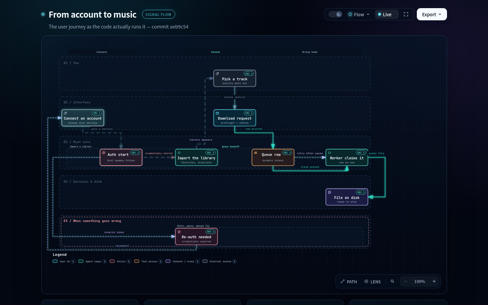
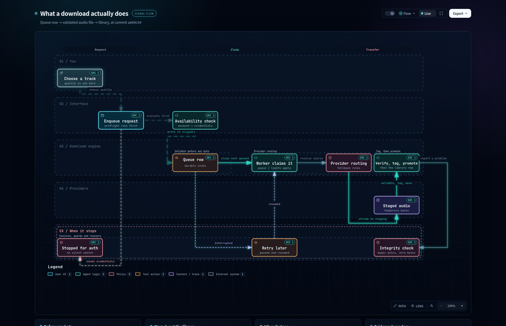
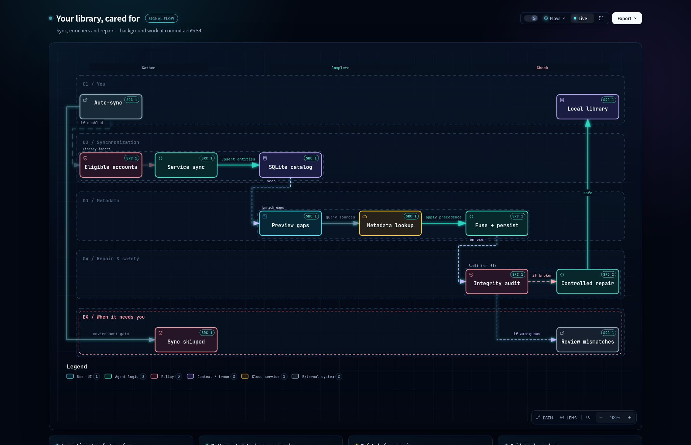
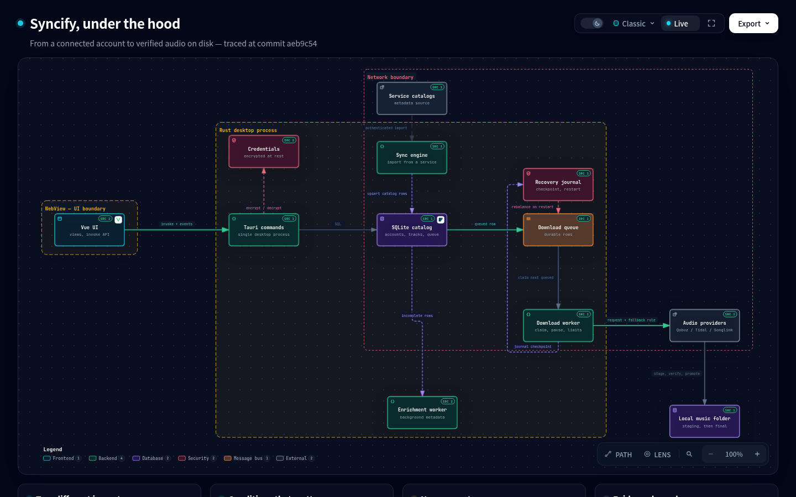

<div align="center">

# Syncify

**Your entire music library. Maximum quality. Under your control.**

Connect Qobuz, Tidal, Spotify, Deezer, SoundCloud and Apple Music. Import
your library, download it in the best quality available, and keep a
perfectly organized local library of real files, ready for Symfonium,
Plexamp, or any player you love.

[English](README.md) · [Español](README.es.md)

**[⬇ Download the latest release](https://github.com/MadManJohnSmith/Syncify/releases/latest)**
· [Build from source](#building-from-source) · [Documentation](docs/README.en.md)

> **Release status (2026-10-12):** The features below are released in
> [Syncify v0.6.0](https://github.com/MadManJohnSmith/Syncify/releases/tag/v0.6.0)
> (PR #26 was squash-merged into `main` as `94376b4`). The download link above
> now points to v0.6.0. See [verification and limitations](#verification-and-limitations)
> for what has not been verified in a real environment.

[](https://github.com/MadManJohnSmith/Syncify/releases/latest)
[](https://github.com/MadManJohnSmith/Syncify/actions/workflows/ci.yml)
[](https://tauri.app/)
[](https://www.rust-lang.org/)
[](https://vuejs.org/)
[](https://tailwindcss.com/)
[](https://www.sqlite.org/)

**Windows** installer & portable · **Linux** AppImage, DEB & tarball

</div>

---

## See it in action


| | |
|---|---|
|  |  |
| *Your whole catalog, unified* | *Synced lyrics, saved as .lrc sidecars* |
|  |  |
| *A download engine you control* | *One login per service, everything stays in sync* |

---

## Why Syncify?

Streaming services rent you your music. If you leave — or a service loses a
license, or a track gets delisted — your library goes with it. Syncify flips
that: it turns "your" catalog into *your* catalog.

- **Leave any service without leaving your music behind.** Import your
  favorites, albums, artists and playlists — plus purchases and listening
  history where the provider exposes them — then migrate to another service,
  or download it and own it outright. Coverage is not identical on every
  provider; the [import-parity matrix](docs/MATRIZ_PARIDAD_IMPORTACION.md)
  has the row-by-row truth.
- **Own real files, not licenses.** Downloads land as properly tagged FLAC
  (up to Hi-Res 24-bit/192 kHz) or MP3, verified against what the provider
  promised.
- **One library, every service.** One import folds every service you connect
  into a single deduplicated library that knows when two services carry the
  same song. Starring a track inside Syncify is a **local** marker: your
  accounts are only written to by the migration tool, not by the library view.

## What can you do with it?

- **Import your library** from Qobuz, Tidal, Spotify, Deezer, SoundCloud,
  Apple Music, or your **local music folders** — tracks, albums, artists,
  playlists. Match and deduplicate your physical disk files with streaming
  catalogs via ISRC and audio hash, keeping a unified metadata score.
- **Listen with the built-in player**: unified audio player docked in the
  bottom status bar with expand-on-hover album art, plus a full-screen player
  view featuring auto-scrolling synced lyrics (`.lrc`), digital booklet (`.pdf`)
  viewing, and animated cover display.
- **Migrate between services**: pick a source, pick a destination, review the
  matches, transfer. Syncify matches on ISRC first, then title and artist, and
  transfers what it matches as **favorites on the destination account**. It
  does not rebuild your playlists over there yet.
- **Download with a strict quality cascade**: cross-service lossless fallback
  (Qobuz ↔ Tidal) prioritizes FLAC/CD quality across providers before stepping
  down, enforcing a strict 320 kbps minimum floor with physical file verification.
- **Get professional-grade metadata automatically**: multi-value artists,
  collaborations, compilations handled correctly, countries, BPM, musical
  key and energy — from MusicBrainz, AcoustID and Last.fm.
- **Synced lyrics as `.lrc` sidecars**, resolved through a 16-strategy
  cascade across 10 providers.
- **High-resolution covers** (including animated ones) saved next to your
  music, organized in artist/album folders under `~/Music/Syncify`.
- **Keep it healthy**: duplicate detection and merge, catalog identity
  audits, integrity checks and a repair pipeline with full audit history.
- **Smart playlists** with rule-based filters, built on your own library.

## How it works

1. **Connect an account.** The app opens a secure login flow per service
   (browser-based OAuth/session capture) and stores your credentials
   encrypted on your machine.
2. **Import.** A unified Rust engine walks the service API with pagination,
   resolves every track's canonical identity (ISRC, provider IDs), enriches
   it, and persists it transactionally, with retry, into your local
   SQLite library.
3. **Download.** Native pipelines handle each provider's delivery format —
   Qobuz hands out direct FLAC URLs, Tidal delivers segmented streams that the
   pipeline assembles — then write real FLAC/MP3 files with the metadata,
   covers and lyrics embedded, and verify what landed on disk matches what
   was promised.
4. **Enjoy anywhere.** The result is a plain folder tree with sidecar files
   — no proprietary database lock-in. Point Symfonium, Plexamp, Roon or any
   player at it and it just works.

Under the hood: a **Tauri 2** desktop app (Rust core + Vue 3 UI) with a typed
IPC layer, a multi-threaded download/repair engine, and a local schema
hardened across **91 SQL migrations in this working tree** (87 committed plus
4 new here). Service logins run through small
audited Python bridges (Playwright, Mutagen, AcoustID).

### How it comes together

Each card below is a live diagram — click one to open the interactive version,
where you can hover, pan and zoom.

<table width="100%">
<tr>
  <td width="50%" valign="top">
    <a href="https://madmanjohnsmith.github.io/Syncify/docs/diagrams/user-journey.en.html"></a>
    <p align="center"><a href="https://madmanjohnsmith.github.io/Syncify/docs/diagrams/user-journey.en.html"><b>From account to music</b></a> — what Syncify actually does for you</p>
  </td>
  <td width="50%" valign="top">
    <a href="https://madmanjohnsmith.github.io/Syncify/docs/diagrams/download-journey.en.html"></a>
    <p align="center"><a href="https://madmanjohnsmith.github.io/Syncify/docs/diagrams/download-journey.en.html"><b>What a download does</b></a> — from your service to your disk, step by step</p>
  </td>
</tr>
<tr>
  <td width="50%" valign="top">
    <a href="https://madmanjohnsmith.github.io/Syncify/docs/diagrams/library-care.en.html"></a>
    <p align="center"><a href="https://madmanjohnsmith.github.io/Syncify/docs/diagrams/library-care.en.html"><b>Your library, cared for</b></a> — sync, order and recovery on its own</p>
  </td>
  <td width="50%" valign="top">
    <a href="https://madmanjohnsmith.github.io/Syncify/docs/diagrams/architecture.en.html"></a>
    <p align="center"><a href="https://madmanjohnsmith.github.io/Syncify/docs/diagrams/architecture.en.html"><b>Under the hood</b></a> — how the pieces fit (for the curious)</p>
  </td>
</tr>
</table>

English diagrams: [from account to music](docs/diagrams/user-journey.en.html) · [what a download does](docs/diagrams/download-journey.en.html) · [your library, cared for](docs/diagrams/library-care.en.html) · [under the hood](docs/diagrams/architecture.en.html)

## Supported services

| | Favorites | Albums/Artists | Playlists | History | Migration target |
|---|---|---|---|---|---|
| **Qobuz** | ✅ | ✅ | ✅ | ✅ | ✅ |
| **Tidal** | ✅ | ✅ | ✅ | ✅ | ✅ |
| **Spotify** | ✅ | ✅ | ✅ | ✅ | ✅ |
| **Deezer** | ✅ | ✅ | ✅ | — ⁽¹⁾ | ✅ |
| **SoundCloud** | ✅ | ✅ ⁽²⁾ | — ⁽¹⁾ | — ⁽¹⁾ | ✅ |
| **Apple Music** | ✅ ⁽³⁾ | ✅ ⁽³⁾ | ✅ | — | ✅ |

⁽¹⁾ Not exposed by the provider's public API — Syncify warns instead of pretending.
⁽²⁾ Derived from each like's publisher metadata; the API has no favorites-albums endpoint.
⁽³⁾ Apple Music imports through its own ISRC-faithful importer (storefront
configurable); the unified-engine path is documented in the parity matrix.

The full, honest per-phase matrix lives in
[`docs/MATRIZ_PARIDAD_IMPORTACION.md`](docs/MATRIZ_PARIDAD_IMPORTACION.md).

## Installation

Grab the latest build from the
[**Releases**](https://github.com/MadManJohnSmith/Syncify/releases) page:

| Platform | Files |
|---|---|
| **Windows** | `Syncify_*_x64-setup.exe` (installer) · `Syncify-Windows-Portable.zip` |
| **Linux** | `*.AppImage` · `*.deb` · `Syncify-Linux-x86_64.tar.gz` (raw binary + bundled binaries) |

Both packages bundle their own copies of the external tools, so a fresh
install has nothing extra to fetch or configure:

- `ffmpeg`, `ffprobe` and `fpcalc` (Chromaprint) travel as `bundle.externalBin`
  entries; the Linux AppImage also carries the minimum GStreamer plugins, without
  which it would launch but make no sound.
- A private Python runtime with the service bridges already installed, so the
  user's Python is never needed.

A few features rely on something the packages cannot bundle:

- **Browser-based logins** (Qobuz, Deezer, SoundCloud, Apple Music) use a
  Chromium-family browser already installed on your system (Chrome, Chromium,
  Brave, Edge, Vivaldi…). Tidal signs in through its device-code page in your
  default browser and Spotify uses the app's own WebView, so those two need
  nothing extra.
- **The AppImage needs FUSE 2** on the host (Ubuntu 23.04+ ships it as
  `libfuse2t64`). If it refuses to start, run it with
  `--appimage-extract-and-run`, or use the DEB or the tarball instead.
- **Audio on Linux** goes through ALSA; on a PipeWire-only system install
  `pipewire-alsa` (or the ALSA plugins).
- **On Windows**, the installer is not code-signed yet: SmartScreen may show
  "Windows protected your PC" once — choose *More info* → *Run anyway*.

2. Run the first-run wizard: connect your accounts, pick your music folder,
   done. Credentials are encrypted and stored in Syncify's own SQLite
   database, inside the app profile folder. The encryption key lives in your
   OS keyring when one is available, and falls back to a `.crypto_key` file
   (mode `0600`, same profile folder) when it is not. On Linux without a Secret
   Service (headless, minimal window manager) that file fallback is what you
   get, by design.

> Building from source? See
> [`src-tauri/binaries/README.md`](src-tauri/binaries/README.md) for how the
> bundled binaries are provided to local production builds.

## FAQ

**Does my library survive uninstalling Syncify?**

Yes. Downloads are plain FLAC/MP3 files in normal folders, with covers and
`.lrc` lyrics as sidecars. No proprietary database holds them together, so
Symfonium, Plexamp, Roon or any player reads them directly.

**Where do my service credentials live?**

Encrypted inside Syncify's own SQLite database, in the app profile folder on
your machine. The encryption key is kept in your operating system's keyring
when one is available — the Windows Credential Manager on Windows, the Secret
Service (GNOME Keyring/KWallet) on Linux; where it is not (headless Linux, no
Secret Service), the key falls back to a `.crypto_key` file with `0600`
permissions in that same profile folder. Each login runs through your browser,
and no credential is ever written to a plain config file.

**What quality can I expect?**

The engine targets the best tier each service offers (FLAC up to Hi-Res
24-bit/192 kHz) and steps down when a tier is unavailable. On a Qobuz→Tidal
cross-service fallback the lossless tier is preferred before any lossy step,
and a candidate below 320 kbps is rejected rather than written. Every file is
re-inspected on disk and verified against what the provider promised before
it counts as done.

**Is there a macOS version?**

No. Windows (installer and portable) and Linux (AppImage, DEB, tarball) are
the supported platforms.

**Can I download from Spotify, Deezer, SoundCloud or Apple Music?**

Not directly from those services. The download engines currently work by
routing a match to a native delivery pipeline (Qobuz and Tidal) or, via a
SongLink resolution step, to an Amazon Music fallback; Spotify, Deezer,
SoundCloud and Apple Music serve no downloadable stream. In practice the app
notes which tracks found no source instead of silently skipping them.

**Is the app finished?**

No, and this page does not claim so. Syncify is pre-1.0, and the features
above are released in v0.6.0. The release does not establish the real-world
behaviour listed under [verification and limitations](#verification-and-limitations).

### Verification and limitations

PR #26 was squash-merged into `main` as `94376b4`; the follow-up docs
change from `5dcf4b6` was squash-merged as `ed440a9` (PR #27). Tag `v0.6.0`
points exactly to `ed440a96f669c264a7e477e76b791e325e900b7f`, and the
[Syncify v0.6.0 release](https://github.com/MadManJohnSmith/Syncify/releases/tag/v0.6.0)
is published with five Linux and Windows assets. Its notes come from
[the v0.6.0 release notes](docs/RELEASE_NOTES_v0.6.0.md). CI (Rust, Frontend,
Python), the release gate, and both release builds (Linux and Windows) are
green on that exact SHA. What has **not** been proven here:

- **The graphical session.** UI layout, audio playback, tray, MPRIS/D-Bus,
  and window-manager behaviour have not been exercised on a real desktop.
- **Live network paths.** No launch login, provider enrichment, download, or
  lyrics resolution ran against real services.
- **Ignored Rust tests.** The 9 ignored tests requiring network access or
  credentials have not been exercised.
- **Windows.** The cross-check for the `x86_64-pc-windows-msvc` target has not
  been run on this machine, although Windows installers were produced by CI.

None of that is proven by the release or by the green CI above, so none of it
should be advertised as working.

The `Release` and `CI` badges above carry no information about the items in
this list.

## Building from source

Requirements: **Rust** (stable), **Node.js 20+**, **Python 3.11+**, and
`ffmpeg`, `flac` and `fpcalc` on your `PATH`. On Linux you also need the
WebKit2GTK/GTK dev packages (`libwebkit2gtk-4.1-dev`, `libgtk-3-dev`,
`libayatana-appindicator3-dev`, `librsvg2-dev`).

```bash
git clone https://github.com/MadManJohnSmith/Syncify.git
cd Syncify

# Tauri CLI (repo root) + frontend dependencies
npm install
cd ui && npm ci && cd ..

# Python bridges (service logins, metadata, fingerprinting)
python3 -m venv .venv
source .venv/bin/activate
pip install -r scripts/requirements.txt
playwright install chromium

# Run in development (with hot UI reload)
npm run dev

# Production build (installer for your OS)
npm run build
```

## Documentation

- [`docs/`](docs/README.en.md) — documentation index (English), with the
  language status of every document; the design specs under `docs/features/`
  are Spanish-only today
- [`docs/MATRIZ_PARIDAD_IMPORTACION.md`](docs/MATRIZ_PARIDAD_IMPORTACION.md) — the living import-parity matrix (Spanish)
- [`docs/LYRICS_16_PROVIDER_MATRIX.md`](docs/LYRICS_16_PROVIDER_MATRIX.md) — the lyrics cascade, audited (English)
- [`docs/Deuda_Tecnica_y_UX.md`](docs/Deuda_Tecnica_y_UX.md) — open technical debt, tracked in the open (Spanish)

## Contributing

Contributions are welcome: bugs, UI improvements, new lyrics or metadata
providers, more services, docs. Fork the repo, create a focused branch, and
open a PR against `main` — the integration branch CI runs on and releases are
cut from. [`CONTRIBUTING.md`](CONTRIBUTING.md) has the exact check commands,
the paths CI ignores, and how to keep the docs in step with the code.

Found a bug? [Open an issue](https://github.com/MadManJohnSmith/Syncify/issues)
with your OS/version, steps to reproduce, and relevant logs — never personal
credentials or tokens.

## License

This repository does not currently grant a license for use, copying,
modification or redistribution. All rights are reserved by their holders.
An explicit license will be defined and versioned before any public
distribution.

---

<div align="center">

<sub>Sincroniza · Descarga · Organiza — <a href="README.es.md">Versión en español</a></sub>

</div>
